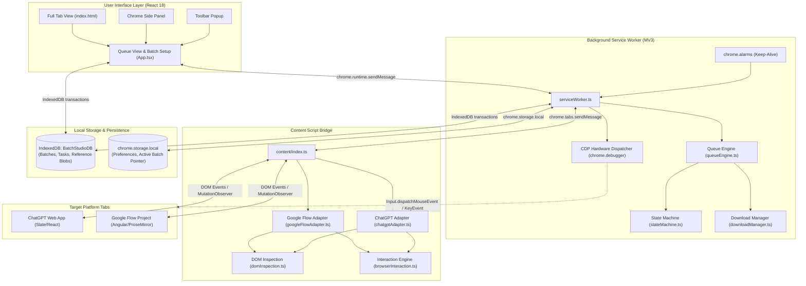
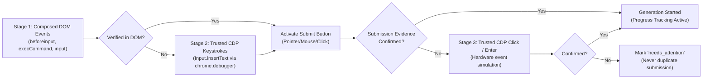

# AI Batch Studio

[](https://developer.chrome.com/docs/extensions/develop/migrate/what-is-mv3)
[](https://www.typescriptlang.org/)
[](https://react.dev/)
[](https://vitejs.dev/)
[](https://vitest.dev/)
[](https://opensource.org/licenses/MIT)

**AI Batch Studio** is an open-source, client-side Chrome extension (Manifest V3) designed to automate sequential batch prompt execution, reference asset management, and media downloading for **ChatGPT** and **Google Flow**.

It operates directly inside your authentic, signed-in browser session. There are no API keys required, no recurring proxy subscription fees, and no fragile headless browser automation.

---

## Table of Contents

- [Why AI Batch Studio?](#why-ai-batch-studio)
- [Supported Platforms & Capabilities](#supported-platforms--capabilities)
  - [ChatGPT](#chatgpt)
  - [Google Flow](#google-flow)
- [System Architecture](#system-architecture)
  - [Architecture Diagram](#architecture-diagram)
  - [Core Components](#core-components)
  - [Progressive Input Escalation & Verification](#progressive-input-escalation--verification)
  - [Queue State Machine](#queue-state-machine)
- [Project Directory Structure](#project-directory-structure)
- [Installation & Quickstart](#installation--quickstart)
  - [Prerequisites](#prerequisites)
  - [Build Commands](#build-commands)
  - [Loading into Google Chrome](#loading-into-google-chrome)
- [Testing & Quality Assurance](#testing--quality-assurance)
  - [Automated Vitest Test Suites](#automated-vitest-test-suites)
  - [Live Browser Smoke Testing](#live-browser-smoke-testing)
- [Developer Guide: Adding a New Adapter](#developer-guide-adding-a-new-adapter)
- [Extended Documentation](#extended-documentation)
- [Data Storage & Privacy](#data-storage--privacy)
- [Permissions Reference](#permissions-reference)
- [License](#license)

---

## Why AI Batch Studio?

Modern generative platforms like **ChatGPT** (DALL-E / GPT-4o image generation) and **Google Flow** (Imagen 3 & Veo video generation) provide web interfaces with features, fine-tuned models, and prompt workflows that are often inaccessible or cost-prohibitive via standard public APIs.

However, generating dozens of scene variations, asset libraries, or sequential storyboards manually requires repetitive copy-pasting, constant tab monitoring, and manual file saving.

AI Batch Studio solves this by bridging a high-performance React management UI with deep DOM inspection and Chrome extension service workers:

1. **Zero Credential Sharing**: Uses your existing logged-in browser session cookies. Your credentials never leave your browser.
2. **Anti-Bot Resilient**: Unlike Selenium or Playwright instances that trigger Cloudflare, reCAPTCHA, or bot protection, AI Batch Studio executes within your regular browsing profile.
3. **Reactive Framework Compatibility**: Handles modern web composer frameworks (Slate.js, Lexical, ProseMirror, React synthetic events, Angular Material, and Trusted Types CSP environments).
4. **Resilient Download Pipeline**: Separates prompt generation tracking from file downloading so network glitches or download interruptions can be retried without re-generating expensive AI credits.

---

## Supported Platforms & Capabilities

### ChatGPT

- **Platform Target**: `https://chatgpt.com/*` and `https://chat.openai.com/*`
- **Workflows**: Multi-turn image generation with automatic turn scoping.
- **Reference Management**: Multi-image attachments into the ChatGPT file upload input.
- **Lossless Download Pipeline**: Direct `Blob` $\rightarrow$ `data:` URL serialization inside the content script context, bypassing Service Worker cross-origin blob restrictions to guarantee high-resolution `.png` file downloads.
- **Progress Tracking**: Differentiates between streaming responses, busy indicators (`[aria-busy="true"]`), and profile menu false-positives.

### Google Flow

- **Platform Target**: `https://flow.google.com/*`, `https://labs.google/*`, and `https://aitestkitchen.withgoogle.com/*`
- **Model-Independent Architecture**: Seamlessly respects whatever model or workflow you have active in your Google Flow project dock (Veo 2, Veo 3, Omni 1.1 Flash, Imagen 3, etc.) without hardcoded selector collisions.
- **Image Generation**: Aspect ratios (`16:9`, `9:16`, `1:1`, `4:3`, `3:4`), output counts (`1`, `2`, `3`, `4`), and reference attachment support.
- **Video Generation**:
  - Full support for Video Workflows: Text-to-Video, Image-to-Video, Start & End Frame, and Reference Ingredients.
  - Video durations (`4s`, `5s`, `6s`, `8s`, `10s`).
  - Native canvas `<flow-video-tile>` component detection and thumbnail inspection.
  - Automatic Single-Item Detail View automation for resolution selection (`360p Original size`, `720p Upscaled`) with animated GIF exclusion.
  - Automatic download and verified `.mp4` file naming.

---

## System Architecture

### Architecture Diagram



---

### Core Components

1. **Background Service Worker (`src/background/serviceWorker.ts`)**:
   - Manages queue lifecycle across browser sessions and popup closures.
   - Listens to `chrome.alarms` to remain alive during long-running video generations.
   - Handles trusted Chrome DevTools Protocol (`chrome.debugger`) hardware clicks and keystrokes when required.
   - Coordinates `chrome.downloads` operations and tracks download completion/interruption.

2. **DOM Adapters (`src/adapters/`)**:
   - Platform-specific abstractions implementing the `PlatformDomAdapter` interface (`src/adapters/types.ts`).
   - Handles reference image upload simulation, prompt entry, progress detection, output element extraction, and download resolution menu selection.

3. **DOM Inspection & Interaction Engine (`src/browser/`)**:
   - `domInspection.ts`: Discovers prompt composers, submit buttons, progress bars, shimmer indicators, error banners, and completed media assets.
   - `browserInteraction.ts`: TrustedHTML-compliant input injection supporting Slate.js, ProseMirror, Lexical, and standard contenteditable containers.

4. **Queue Engine & State Machine (`src/core/`)**:
   - `queueEngine.ts`: Executes batches sequentially, tracks observation windows, and enforces safe timeout boundaries.
   - `stateMachine.ts`: Deterministic finite-state machine handling task states.
   - `fileNaming.ts`: Evaluates filename templates (`{number}`, `{project}`, `{prompt}`, `{date}`, `{time}`) with automatic numbering padding.

5. **Local Storage Engine (`src/storage/`)**:
   - `db.ts`: IndexedDB wrapper storing batches, tasks, and media reference blobs ($\le 20\text{ MB}$).
   - `preferences.ts`: User settings storage via `chrome.storage.local`.

---

### Progressive Input Escalation & Verification

To ensure reliable prompt submission across diverse browser environments, AI Batch Studio utilizes a 4-stage progressive escalation system:



- **TrustedHTML Compliance**: Avoids direct assignments to `element.innerHTML` that violate strict Trusted Types policies on Google applications, utilizing safe DOM node replacement (`replaceChildren` and `removeChild`).
- **Submission Evidence Verification**: Verifies generation start via multiple signals:
  1. Composer content cleared or disabled.
  2. Stop button or cancel streaming control appearing.
  3. Progress spinner, percentage text, or shimmer element rendered.
  4. New tile or card placeholder inserted into the canvas grid.
- **Uncertain Submission Safeguard**: If prompt submission cannot be verified with 100% confidence, the task transitions to `needs_attention` rather than risking duplicate token usage or unwanted generations.

---

### Queue State Machine

Each task in a batch moves through an explicit, auditable state lifecycle:

| State | Description | Next Permitted States |
| :--- | :--- | :--- |
| `pending` | Waiting in queue. | `preparing`, `skipped` |
| `preparing` | Resolving references and verifying tab readiness. | `submitting`, `failed`, `needs_attention` |
| `submitting` | Injecting prompt and activating generation trigger. | `generating`, `failed`, `needs_attention` |
| `generating` | Actively monitoring progress (spinners, %, timers). | `downloading`, `completed`, `failed` |
| `downloading` | Media detected; executing download pipeline. | `completed`, `download_failed` |
| `completed` | Media successfully saved to disk. | *(Terminal state)* |
| `download_failed`| Generated successfully, but download encountered an error. | `downloading` *(Retry Download without regenerating)* |
| `needs_attention`| Platform requires user interaction (CAPTCHA, login, quota).| `submitting`, `pending` |
| `paused` | Queue execution paused by user. | `pending`, `preparing` |
| `failed` | Task execution encountered an unrecoverable error. | `pending` *(Manual retry)* |

---

## Project Directory Structure

```text
batch-studio/
├── public/
│   ├── icons/                  # Extension icons (16, 32, 48, 128px)
│   └── manifest.json           # Manifest V3 configuration
├── scripts/
│   ├── package-zip.mjs         # Packages dist/ into ai-batch-studio.zip
│   ├── postbuild.mjs           # Copies manifest, icons, and assets to dist/
│   └── reload-ext.cjs          # Hot-reloads extension in Chrome debug sessions
├── src/
│   ├── adapters/               # Platform-specific DOM adapters
│   │   ├── chatgptAdapter.ts   # ChatGPT image generation adapter
│   │   ├── googleFlowAdapter.ts# Google Flow image & video adapter
│   │   ├── tabBridgeAdapter.ts # Content script messaging bridge
│   │   └── types.ts            # Adapter interfaces & contracts
│   ├── background/
│   │   └── serviceWorker.ts    # Manifest V3 background service worker
│   ├── browser/
│   │   ├── browserInteraction.ts # DOM event dispatching & typing simulation
│   │   └── domInspection.ts    # Selectors, asset detection & state queries
│   ├── content/
│   │   └── index.ts            # Content script entry point
│   ├── core/
│   │   ├── fileNaming.ts       # Filename template rendering & numbering
│   │   ├── prefixComposer.ts   # Shared instruction / prefix handling
│   │   ├── promptParser.ts     # TXT & CSV import parsers
│   │   ├── queueEngine.ts      # Queue execution coordinator
│   │   ├── referenceManager.ts # Image attachment validation
│   │   ├── stateMachine.ts     # Task state transitions
│   │   └── timeoutPolicy.ts    # Safe observation timeouts
│   ├── downloads/
│   │   └── downloadManager.ts  # Chrome Downloads API wrapper
│   ├── services/
│   │   └── tabDiscovery.ts     # Active tab resolution & health checks
│   ├── storage/
│   │   ├── db.ts               # IndexedDB storage for batches & blobs
│   │   └── preferences.ts      # Settings persistence via chrome.storage
│   ├── types/
│   │   └── models.ts           # Shared TypeScript interfaces & types
│   └── ui/                     # React 18 frontend
│       ├── components/
│       │   └── QueueView.tsx   # Queue Monitor & task list view
│       ├── App.tsx             # Main application layout & batch setup
│       ├── backgroundClient.ts # Background service worker client
│       ├── main.tsx            # React root mount
│       └── styles.css          # Design system & dark theme styles
├── tests/                      # Automated Vitest test suites
│   ├── adapters.test.ts        # ChatGPT & Flow adapter fixture tests
│   ├── browserInteraction.test.ts # Human typing & DOM event tests
│   ├── flowTabDetection.test.ts   # Tab discovery & readiness tests
│   ├── integration.test.ts     # End-to-end queue engine integration tests
│   ├── setup.ts                # Test environment shims & fake IndexedDB
│   ├── uiAndBackground.test.tsx# React UI & service worker tests
│   └── unit.test.ts            # Parser, template & state machine unit tests
├── package.json
├── tsconfig.json
└── vite.config.ts
```

---

## Installation & Quickstart

### Prerequisites

- **Node.js**: v20.x or higher
- **Package Manager**: `npm` (v10+)
- **Browser**: Google Chrome (v116+ recommended for full Manifest V3 SidePanel and Offscreen support)

### Build Commands

```bash
# 1. Clone repository
git clone git@github.com:AssemDeghady/ai_batch_studio.git
cd ai_batch_studio

# 2. Install dependencies
npm install

# 3. Type check
npm run typecheck

# 4. Run automated tests
npm test

# 5. Build unpacked extension (outputs to dist/)
npm run build

# 6. Optional: Create production zip bundle
npm run package
```

### Loading into Google Chrome

1. Build the extension using `npm run build`.
2. Open Google Chrome and navigate to `chrome://extensions/`.
3. Enable **Developer mode** toggle in the top-right corner.
4. Click **Load unpacked**.
5. Select the `dist/` directory inside this repository.
6. The **AI Batch Studio** icon will appear in your extensions toolbar. Pin it for quick access.

---

## Testing & Quality Assurance

### Automated Vitest Test Suites

The codebase includes comprehensive unit, integration, and simulated DOM tests:

```bash
# Run all test suites
npm test

# Run tests in watch mode during development
npm run test:watch
```

The automated test suites cover:
- **`unit.test.ts`**: CSV/TXT parsing, filename formatting, and state machine validation.
- **`integration.test.ts`**: End-to-end queue lifecycle with pauses, retries, and errors.
- **`adapters.test.ts`**: DOM fixture tests simulating ChatGPT and Google Flow responses.
- **`browserInteraction.test.ts`**: Typing simulation, event bubbling, and CDP escalation.
- **`flowTabDetection.test.ts`**: Tab readiness detection, loading states, and URL resolution.
- **`uiAndBackground.test.tsx`**: React UI components, batch creation, and queue controls.

### Live Browser Smoke Testing

For real-time testing against live platforms, you can launch an isolated Chrome debug instance:

```bash
# Windows PowerShell example
& "C:\Program Files\Google\Chrome\Application\chrome.exe" `
  --remote-debugging-port=9222 `
  --user-data-dir="$HOME\.chrome_debug_session"
```

1. Log into your ChatGPT or Google Flow account in this window.
2. Load the unpacked extension from `dist/`.
3. Create a batch with 1–2 test prompts and click **Start Batch Queue** to verify live selectors.

---

## Developer Guide: Adding a New Adapter

To add support for a new AI platform (e.g. Midjourney Web, Claude, Runway, etc.), implement the `PlatformDomAdapter` interface located in [`src/adapters/types.ts`](src/adapters/types.ts):

```typescript
export interface PlatformDomAdapter {
  platform: PlatformId;
  checkAvailability(taskType: TaskType, settings?: GenerationSettings): Promise<AdapterAvailabilityResult>;
  attachReferences(task: TaskRecord, references: ResolvedReferenceAttachment[]): Promise<AdapterReferenceResult>;
  submitTask(task: TaskRecord, references: ResolvedReferenceAttachment[], options?: AdapterSubmissionOptions): Promise<AdapterSubmissionResult>;
  getTaskStatus(task: TaskRecord): Promise<AdapterStatusInspection>;
  getResults(task: TaskRecord): Promise<DetectedPlatformAsset[]>;
  downloadResult(asset: DetectedPlatformAsset, suggestedFilename: string): Promise<AdapterDownloadActionResult>;
  recoverTask(task: TaskRecord): Promise<AdapterStatusInspection>;
  dispose(): Promise<void>;
}
```

### Steps to Implement:

1. **Create Adapter**: Create `src/adapters/<platform>Adapter.ts` and implement the interface.
2. **Register Platform**: Add the platform identifier to `PlatformId` in `src/types/models.ts`.
3. **Add Content Script Match**: Update `host_permissions` and `content_scripts.matches` in `public/manifest.json`.
4. **Instantiate in Content Script**: Add a detection check in `src/content/index.ts` to instantiate your adapter when the tab URL matches.
5. **Add Fixture Tests**: Add simulated DOM fixture tests under `tests/adapters.test.ts`.

---

## Extended Documentation

For in-depth technical guides, specifications, and contributor workflows, consult the documents in the [`docs/`](docs/) directory:

- [**System Architecture (`docs/ARCHITECTURE.md`)**](docs/ARCHITECTURE.md): Deep-dive into the Manifest V3 service worker lifecycle, input escalation pipeline, state machine, and IndexedDB schema.
- [**DOM Adapters Guide (`docs/DOM_ADAPTERS.md`)**](docs/DOM_ADAPTERS.md): Detailed mechanics of `ChatGPTDomAdapter` and `GoogleFlowDomAdapter`, framework quirks (Slate, ProseMirror, Angular Material), and creating new adapters.
- [**Import Formats & Template Tokens (`docs/IMPORT_FORMATS.md`)**](docs/IMPORT_FORMATS.md): Specifications for `.txt` and RFC 4180 `.csv` batch imports, column schemas, global prompt prefixing, and filename template tokens (`{number}`, `{project}`, `{prompt}`, `{date}`, `{time}`).
- [**Contributing Guide (`docs/CONTRIBUTING.md`)**](docs/CONTRIBUTING.md): Development environment setup, coding standards (Trusted Types, TypeScript strict mode), testing protocols, and pull request checklist.

---

## Data Storage & Privacy

- **100% Client-Side**: All prompt drafts, queue records, and downloaded media remain entirely on your local machine. No external servers or telemetry are used.
- **IndexedDB (`BatchStudioDB`)**: Stores high-volume data (batch records, task history, and base64/binary image reference blobs up to 20 MB each).
- **`chrome.storage.local`**: Stores lightweight user preferences (default platform, numbering settings, timeout configs).
- **No Credential Access**: AI Batch Studio does not read, store, or transmit your passwords, API keys, or session tokens.

---

## Permissions Reference

| Permission | Purpose |
| :--- | :--- |
| `storage` | Saves user settings and queue state pointers. |
| `downloads` | Saves generated images and videos to `Downloads/<Subfolder>/`. |
| `alarms` | Keeps the background service worker active during long generations. |
| `notifications` | Notifies you when batches finish or require attention. |
| `tabs` & `scripting` | Connects the extension bridge to open generation tabs. |
| `sidePanel` | Allows running AI Batch Studio in Chrome's Side Panel. |
| `debugger` | Dispatches trusted hardware input events when background tabs require native clicks. |
| `host_permissions` | Allows content scripts to interact with ChatGPT and Google Flow domains. |

---

## License

This project is open-source software licensed under the [MIT License](LICENSE).
