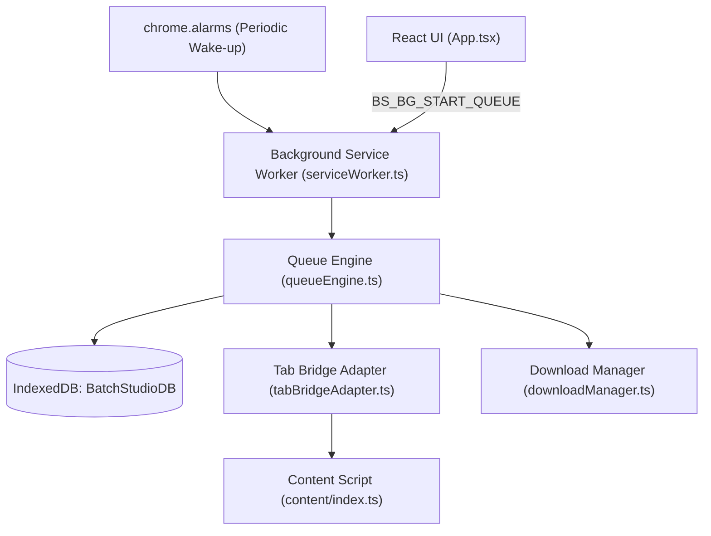
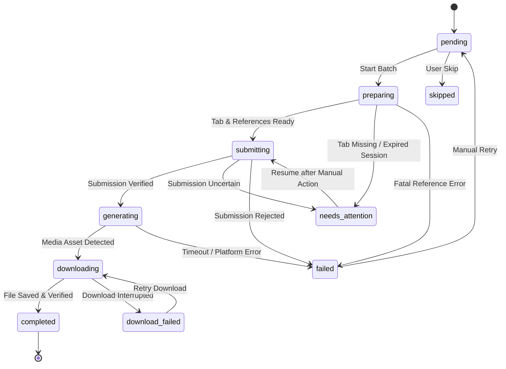

# AI Batch Studio Architecture

This document provides a deep technical overview of the architecture, design patterns, and subsystems of **AI Batch Studio**.

---

## 1. High-Level Design Principles

AI Batch Studio is built as a **Manifest V3 Chrome Extension** designed to execute repetitive AI image and video generation queues directly inside a user's authenticated web session.

### Core Architectural Principles:
1. **Zero Credential Exposure**: The extension never intercepts, stores, or transmits user passwords, authentication tokens, or cookies. It relies exclusively on the browser's native cookie jar.
2. **Local-First Persistence**: All batch definitions, prompt histories, queue state, and reference media files are stored locally on the user's machine using `IndexedDB` and `chrome.storage.local`.
3. **Decoupled Execution & Observation**: Generation submission, generation observation, and file downloading are separated into distinct lifecycle stages to prevent duplicate generations or loss of assets during network fluctuations.
4. **Progressive Input Escalation**: When interacting with complex reactive web applications (Slate.js, ProseMirror, Angular, Lit), AI Batch Studio begins with standard DOM events and progressively escalates to hardware-level Chrome DevTools Protocol (`chrome.debugger`) events only if necessary.
5. **Trusted Types & CSP Compliance**: All DOM modifications adhere to modern Content Security Policy requirements (e.g., Google's TrustedHTML policies) without relying on prohibited string-based `innerHTML` assignments.

---

## 2. Manifest V3 Service Worker & Lifecycle

In Manifest V3, background pages are replaced by ephemeral **Service Workers** that can be terminated by the browser when idle. AI Batch Studio maintains reliable long-running queues through several coordinated mechanisms:

### Keep-Alive Mechanism:
- **`chrome.alarms`**: Configured to fire every 1 minute (`BS_ALARM_QUEUE_CHECK`) while a queue is active, ensuring the service worker is re-instantiated if terminated during extended video rendering jobs (which often take 30–120 seconds).
- **Port Keep-Alive**: When the UI popup, side panel, or full tab is open, a long-lived `chrome.runtime.Port` maintains continuous communication.
- **State Recovery**: Upon reactivation, the service worker queries `chrome.storage.local` for the active batch pointer, reloads the current task from `IndexedDB`, verifies tab responsiveness, and resumes observation without duplicate submissions.

---

## 3. Interaction & Input Escalation Layer

Modern generative web composers do not use simple `<input>` or `<textarea>` elements. They use sophisticated rich-text editor frameworks:
- **ChatGPT**: Uses Slate.js inside a custom contenteditable container.
- **Google Flow**: Uses ProseMirror inside an Angular Material component hierarchy.

### The 4-Stage Input Escalation Pipeline:

1. **Stage 1: DOM Selection & Composed Events**
   - Moves an explicit DOM `Selection` range into the editor's text leaf node.
   - Dispatches a cancelable `beforeinput` `InputEvent` (`inputType: "insertText"`).
   - Executes `document.execCommand('insertText', false, text)` to trigger internal editor state updates.
   - Dispatches synthetic `input` and `selectionchange` events.

2. **Stage 2: TrustedHTML-Compliant DOM Fallback**
   - If the editor does not update and is not Slate.js (which must retain its React weakmaps), the editor clears children using `removeChild` / `replaceChildren` rather than string `innerHTML = ''`.
   - Injects a standard `
` text node and dispatches reactive `InputEvent`s.

3. **Stage 3: Trusted Hardware Keystrokes (CDP)**
   - If the submit button remains disabled or the composer fails DOM verification, the background service worker attaches `chrome.debugger` to the tab and issues hardware-level `Input.insertText` commands.
   - This guarantees that framework-level listeners (such as ProseMirror transactions) treat the input as native user typing.

4. **Stage 4: Verified Submission Confirmation**
   - The submit button is activated via composed pointer/mouse/click sequences.
   - If unconfirmed, hardware `Input.dispatchMouseEvent` and `Input.dispatchKeyEvent` (Enter key) are triggered.
   - The system inspects the DOM for observable submission evidence:
     - Prompt text cleared from composer.
     - Submit button becoming disabled.
     - Active progress indicator, spinner, or percentage appearing.
     - Generation stop/cancel button appearing.
     - New tile or card placeholder inserted into the canvas grid.
   - If submission evidence cannot be verified with 100% confidence, the task transitions to `needs_attention` rather than risking duplicate token expenditure.

---

## 4. Finite State Machine & Queue Engine

Task progression is strictly governed by a deterministic state machine in [`src/core/stateMachine.ts`](file:///w:/Projects/Web/Batch-Studio/src/core/stateMachine.ts).

### State Transition Diagram:

### Decoupled Download Lifecycle:
If a task finishes generation on the platform but the browser fails to download the file (e.g., download permission denied, disk full, temporary network drop):
- The task transitions to `download_failed`.
- The user is presented with a **Retry Download** action.
- Retrying does **not** re-submit the prompt or re-generate the media; it directly re-triggers the download pipeline from the existing asset card.

---

## 5. Storage Architecture

AI Batch Studio employs a tiered local storage strategy:

| Storage Engine | Key / Store | Data Stored |
| :--- | :--- | :--- |
| `chrome.storage.local` | `batch_studio_preferences` | User UI preferences, default platform, auto-numbering configs, filename template. |
| `chrome.storage.local` | `batch_studio_active_queue` | Pointer to active batch ID, running state (`running`, `paused`, `stopped`). |
| `IndexedDB` (`BatchStudioDB`) | `batches` store | `BatchRecord` objects (metadata, task counts, creation timestamps). |
| `IndexedDB` (`BatchStudioDB`) | `tasks` store | `TaskRecord` objects (prompts, generation settings, status history, asset URLs). |
| `IndexedDB` (`BatchStudioDB`) | `references` store | `ReferenceRecord` objects (image binary blobs, MIME types, dimensions, roles). |

### Media Blob Handling:
Reference images are stored as raw `Blob` objects in IndexedDB. When passed to content scripts, they are resolved as ephemeral Data URLs and converted back into `File` objects inside synthetic `DataTransfer` payloads to populate standard file inputs without filesystem leaks.

---

## 6. Download Pipeline & Cross-Context Serialization

Chrome's Manifest V3 security model restricts `chrome.downloads.download` from directly fetching `blob:https://...` URLs from background service workers because blob URLs are strictly scoped to the renderer process of the tab that created them.

AI Batch Studio overcomes this with a **lossless content script bridge**:
1. When an asset is detected as a `blob:` URL (common on ChatGPT), the content script fetches the blob locally within the tab origin.
2. The blob is read via `FileReader.readAsDataURL` into a Base64 data URI.
3. The data URI is returned to the background worker, which passes it to `chrome.downloads.download`.
4. Chrome writes the bytes to disk without cross-origin re-fetching or resolution loss.
